<div align="center">

# F/A-18 Hornet Anatomy

**McDonnell Douglas F/A-18A &nbsp;·&nbsp; General Electric F404-GE-400 &nbsp;·&nbsp; M61A1 cannon**

An interactive 3D technical drawing of a carrier strike fighter, held still at full power and drawn part by part.<br />
Light the afterburners, take the airframe apart down to the radar, cannon, cockpit and fuel cells, fire the gun, then take one engine apart module by module.

[](https://msreeganeshnaik.github.io/fa18-hornet-anatomy/)

[](https://threejs.org/)
[](https://www.khronos.org/webgl/)
[](dist/hornet.html)
[](#stills-rendered-on-your-own-gpu)
[](LICENSE)

[**Live demo**](https://msreeganeshnaik.github.io/fa18-hornet-anatomy/) &nbsp;·&nbsp; [Tour](#the-tour) &nbsp;·&nbsp; [What's inside](#whats-inside) &nbsp;·&nbsp; [Stills](#stills-rendered-on-your-own-gpu) &nbsp;·&nbsp; [Film](#the-film) &nbsp;·&nbsp; [Run it](#run-it) &nbsp;·&nbsp; [How it's built](#how-it-is-built) &nbsp;·&nbsp; [The aircraft](#fa-18a-at-a-glance) &nbsp;·&nbsp; [Sources](#sources)

<br />

<a href="https://msreeganeshnaik.github.io/fa18-hornet-anatomy/">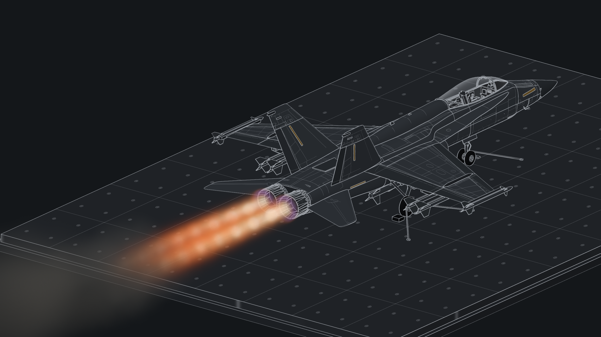</a>

<sub>Both F404-GE-400s in full afterburner: 32,000 lbf, nozzles wide open.</sub>

</div>

<br />

Every picture on this page was drawn by the page itself on an Apple M4 Pro, not by a software renderer. See [Stills](#stills-rendered-on-your-own-gpu).

---

## The tour

<table>
<tr>
<td width="50%">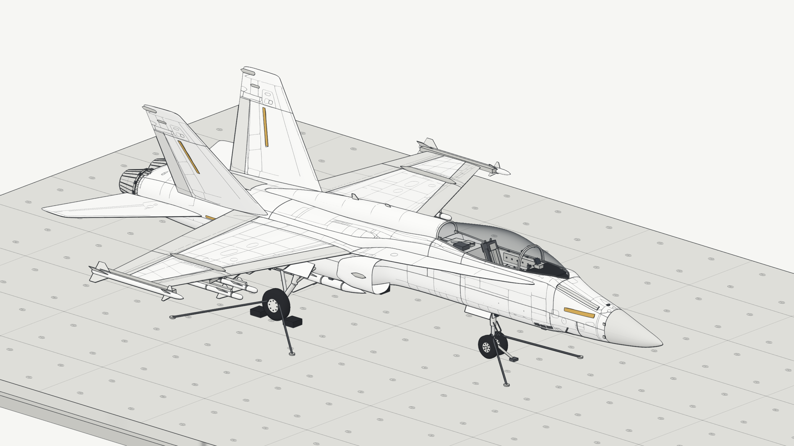<br /><sub><b>The aircraft.</b> Built to the McDonnell Douglas three-view: every outline measured off its top, side and front views.</sub></td>
<td width="50%">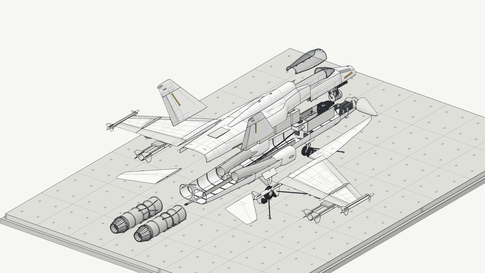<br /><sub><b>Taken apart.</b> Skin, wings, fins, tanks, ducts, gear and both engines lift away in order.</sub></td>
</tr>
<tr>
<td>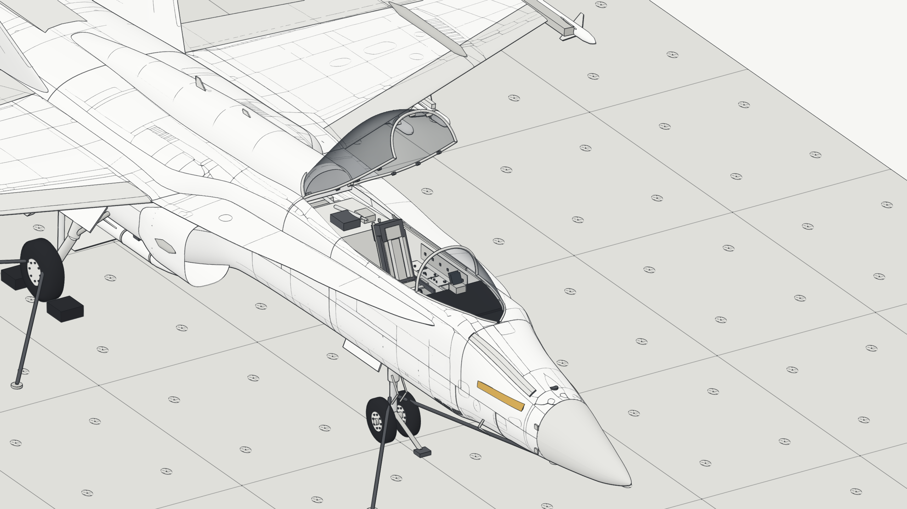<br /><sub><b>Cockpit.</b> Canopy up on its aft hinge, ejection seat, panel and consoles, boarding ladder down.</sub></td>
<td>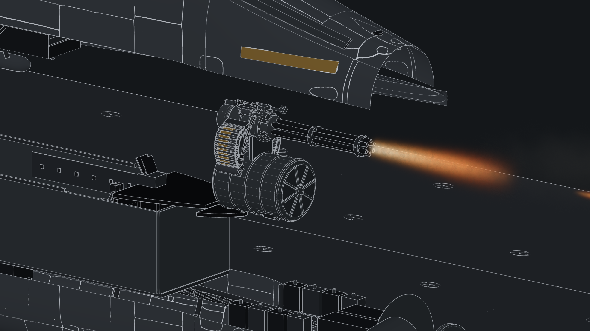<br /><sub><b>Cannon.</b> The M61A1 spins up and fires from its 578-round drum once the nose is opened.</sub></td>
</tr>
<tr>
<td>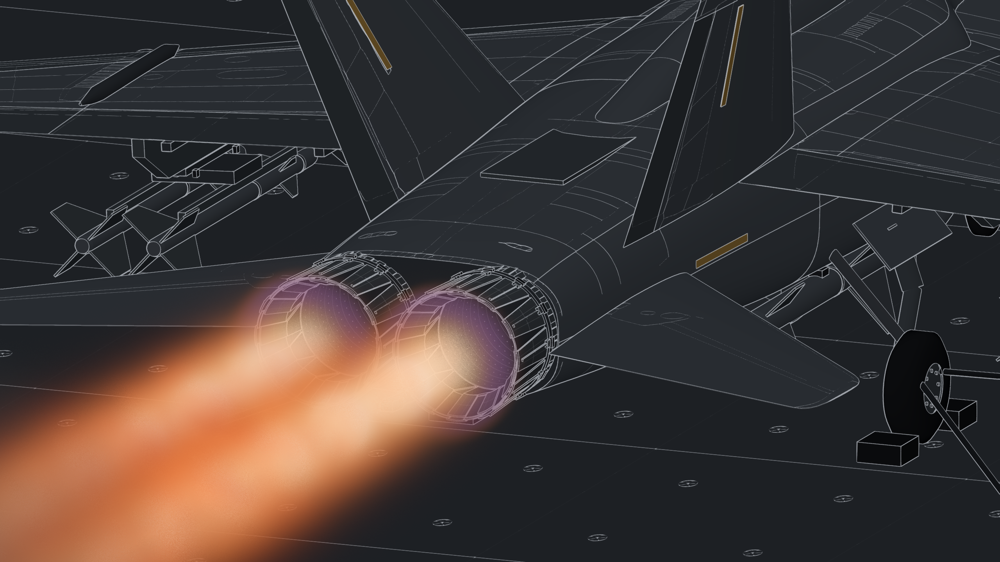<br /><sub><b>Nozzles.</b> Twelve flaps and seals each, opening and closing with the throttle.</sub></td>
<td>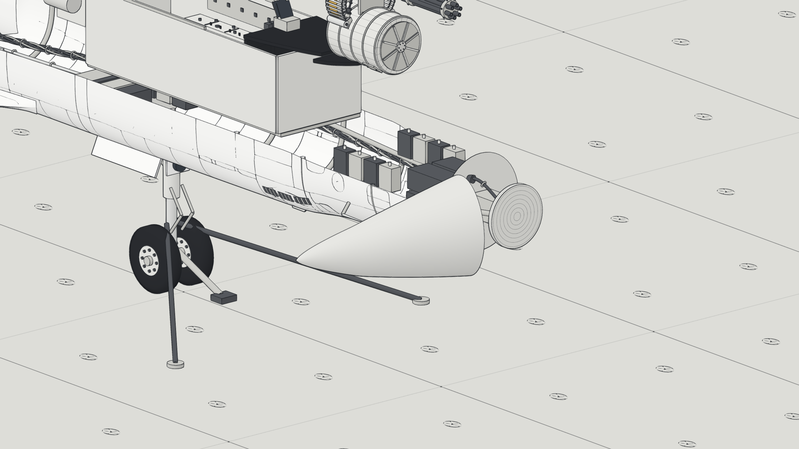<br /><sub><b>Radar.</b> The radome swings aside on its hinge to show the antenna and the avionics behind it.</sub></td>
</tr>
<tr>
<td>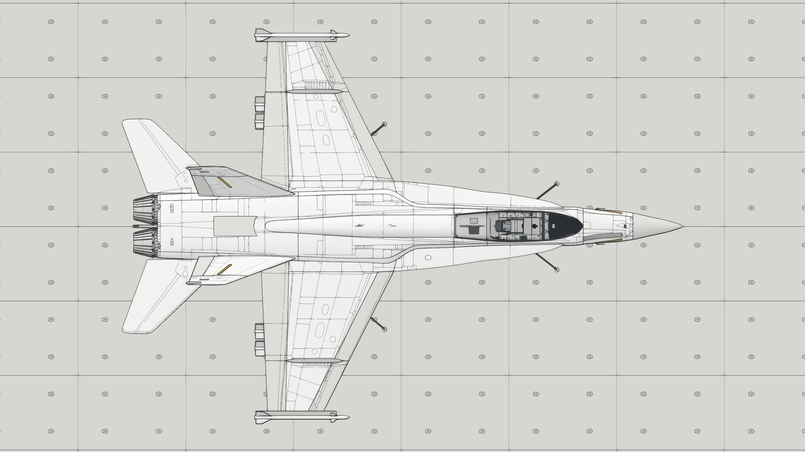<br /><sub><b>Plan view.</b> The panel lines are the drawing's own line work, traced into vectors and laid on the skin.</sub></td>
<td>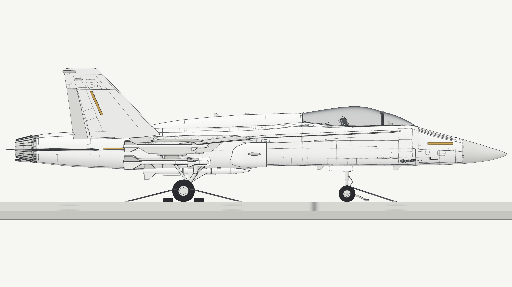<br /><sub><b>Profile.</b> 17.07 m long, 4.66 m to the fin tips.</sub></td>
</tr>
<tr>
<td>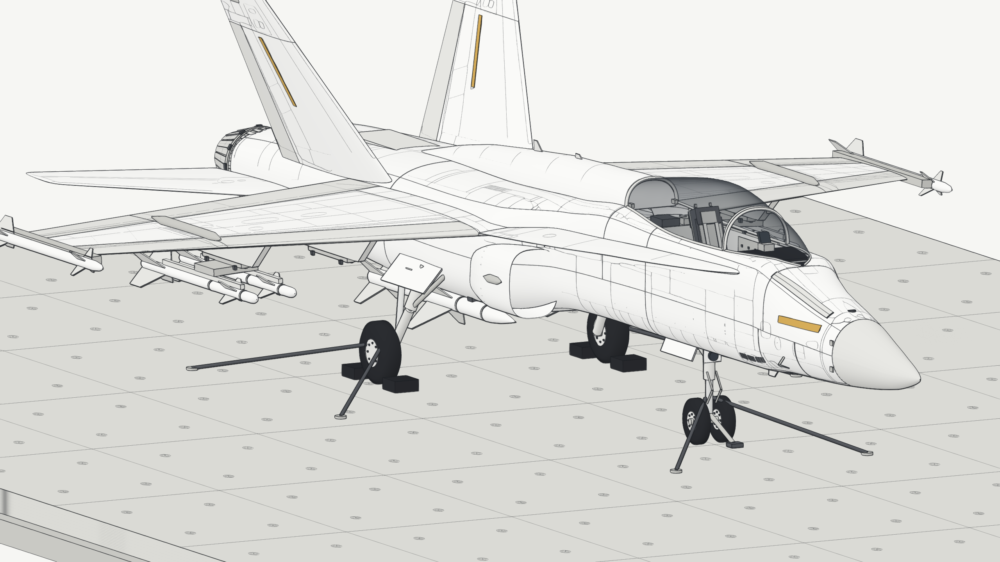<br /><sub><b>Stores.</b> Wingtip AIM-9s, fuselage AIM-7s, and five wing loads to cycle through, or empty pylons.</sub></td>
<td>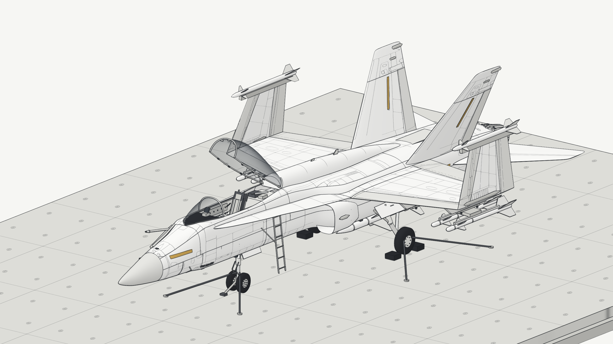<br /><sub><b>On deck.</b> Wings folded, canopy open, ladder down, refuelling probe out of its bay.</sub></td>
</tr>
<tr>
<td>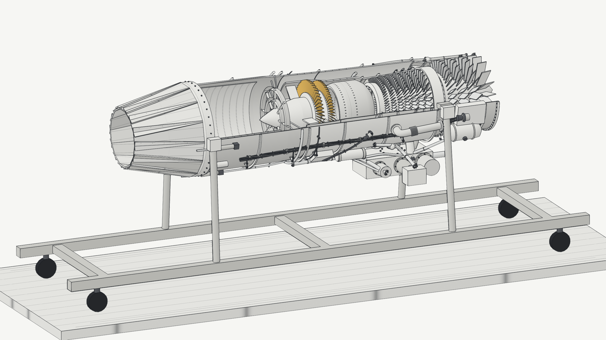<br /><sub><b>F404-GE-400.</b> One engine on a stand, cut open from fan to nozzle.</sub></td>
<td>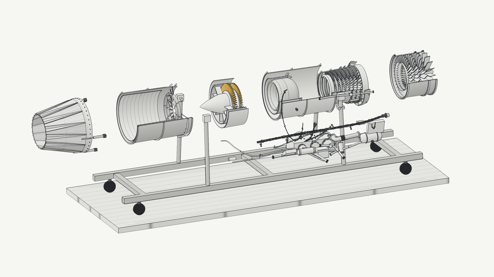<br /><sub><b>Module by module.</b> Fan, compressor, combustor, turbines, afterburner, nozzle, gearbox, lines and harness.</sub></td>
</tr>
</table>

<div align="center">
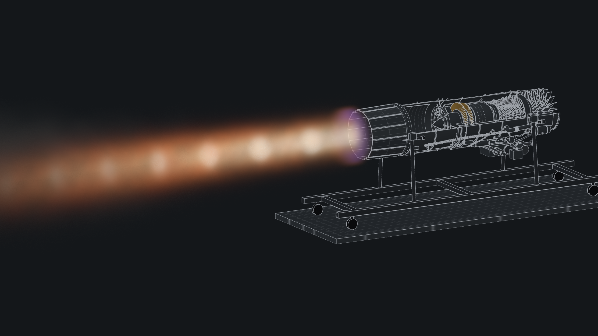
<br /><sub>The same engine on the stand, in full afterburner.</sub>
</div>

---

## What's inside

**The aircraft**

- The whole airframe to the F/A-18A three-view: fuselage lofted through 23 measured stations, aerofoil-section wings, fins and stabilators, leading-edge extensions, a canopy and cockpit cut from one outline.
- Inside the skin: radar and radome, the M61A1 gun bay, cockpit and ejection seat, avionics bays, fuel cells, intake ducts, keel and frames, landing gear with hinged doors, both engines.
- Fittings from the drawing: pitot probes, gun gas vents, formation lights, antennas, ECM fairings, chaff and flare dispensers, pylons, the centreline station.
- Things that move: wing fold, canopy and boarding ladder, refuelling probe with its two bay doors, radome, nozzle flaps, both spools of each engine.
- Stores: wingtip AIM-9 Sidewinders and fuselage AIM-7 Sparrows, plus dual AIM-9, AIM-7F, AGM-78, AGM-65 or AGM-84 on the wing pylons, or the pylons empty.

**The engines**

- Throttle from idle through military to full afterburner; thrust, fuel flow and nozzle position follow the published F404-GE-400 figures, with altitude from the standard atmosphere.
- Flame, shock diamonds and smoke are ray-marched volumes tied to the thrust, at every power setting.
- A second, more detailed F404 on a stand: fan, compressor, combustor, turbines, afterburner, nozzle, accessory gearbox, fuel, oil and air lines, wiring harness, each one selectable.

**The cannon**

- Six barrels, housing, drive, 578-round drum and feed chutes with the rounds in them.
- With the aircraft taken apart, a switch fires it: the barrels spin up, rounds leave at the true rate of 6,000 a minute, and the drum counts down.

**The drawing**

- A technical-drawing look: flat toon shading with ink outlines found from depth and normals, panel lines drawn as distance fields so they stay sharp at any zoom, see-through canopy glass.
- Light and dark sheets. Orbit, pan, zoom, or fly with the keys.

**Keys:** `Space` engines on and off · `[` `]` throttle · `X` take apart · `F` fold wings · `C` canopy · `L` stores · `P` probe · `G` fire (taken apart) · `R` reset view · `W A S D Q E` fly.

---

## Stills, rendered on your own GPU

The page can draw any view as a finished picture at any size, on whatever GPU the browser is using. There is no separate renderer: a still is one frame of the live drawing, with the pixel budget lifted.

- Geometry and ink are drawn at twice the picture size (12032 × 6768 for a 6K still), with 4× MSAA on the fills, filtered down, then given an edge-smoothing pass.
- A 6016 × 3384 still takes under a second on an Apple M4 Pro.
- Line weight scales with the picture, so a 6K still has the same proportions as the page.

Fourteen set pieces are built in (`src/app/65-stills.js`): a pose, a theme and a camera each. The pictures in this README are those fourteen at 2560 × 1440. The 6K versions are 2 to 13 MB each, so they are made on demand and not kept in the repository.

**In the browser.** Open the [live page](https://msreeganeshnaik.github.io/fa18-hornet-anatomy/), open the console, and:

```js
HORNET.gpu()                                  // which GPU this is
await HORNET.still("01-afterburner")          // 6016 × 3384 PNG, saved to Downloads
await HORNET.still("07-plan", { w: 2560, h: 1440 })
await HORNET.render({ w: 6016, h: 3384, theme: "dark" })   // whatever is on screen now
HORNET.STILLS.map((s) => s.name)              // the fourteen
```

**From the command line.** This opens the page in your installed Chrome, with hardware acceleration, and saves every still:

```bash
npm install
npm run render                       # all fourteen at 6016 × 3384 → docs/images/6k/
npm run render -- 01-afterburner 07-plan --w=2560 --h=1440 --out=docs/images/screenshots
```

It prints the GPU it found and refuses to run on a software renderer unless you pass `--software`.

---

## The film

`film.html` is the same page with a director on top (`film/director.js`). It renders a 45-second cut of the drawing at 3840 × 2160, 60 frames a second, entirely in the browser on your own GPU: every frame is drawn at 7680 × 4320 and filtered down, type is drawn as vectors on a 2D canvas, the browser's hardware H.264 encoder does the encoding, and the page muxes the MP4 with the soundtrack. On an Apple M4 Pro the whole film takes about two minutes.

1. Open [`/film.html`](https://msreeganeshnaik.github.io/fa18-hornet-anatomy/film.html) in Chrome or another Chromium browser.
2. Choose a soundtrack, press **Render 3840 × 2160**, then **Save MP4**.

The cut is locked to one particular track at 134 beats a minute: an eight-bar build over bare line drawings, the drop, fifteen bars of the aircraft at work, the track's own ending, then the title held in silence. The soundtrack itself is not in this repository. To cut to a different track, change the tempo, the drop time and the edit list at the top of `film/director.js`; the shots and titles are plain lists below them.

Details worth knowing: the sound is fed to the encoder 2,112 samples early, because an AAC encoder puts that much run-in at the head of the stream and players play it; and the page finds the drop in the decoded track for itself, because decoders disagree by a few milliseconds about where an MP3 starts.

---

## Run it

**Just view it:** go to the [live site](https://msreeganeshnaik.github.io/fa18-hornet-anatomy/), or download [`dist/hornet.html`](dist/hornet.html) and open it in a current Chrome, Edge, Safari or Firefox. It needs an internet connection the first time, to load three.js and two fonts from their CDNs, and it needs WebGL 2.

**Serve it locally** (some browsers restrict module scripts on `file://`):

```bash
python3 -m http.server 8000
# then open http://localhost:8000/dist/hornet.html
```

**Build from source.** `dist/hornet.html` is generated; edit `src/` and rebuild:

```bash
npm install
npm run build          # src/ → dist/hornet.html
```

<details>
<summary><b>Headless checks, scripting, hosting</b></summary>
<br />

`npm run shot` runs the page in Chromium with the SwiftShader software renderer, maps the three.js CDN to `node_modules`, runs a list of actions and saves screenshots plus the console output. It is for checking that nothing is broken, not for pictures:

```bash
npx playwright install chromium   # once
npm run shot -- '[["wait",5000],["eval","HORNET.setRunning(false); HORNET.setExplode(true)"],["wait",3000],["shot","apart","#fig"]]'
# → shots/apart.png
```

`scripts/checks.json` holds the fit checks used while building the model: nothing inside pokes through the skin, nothing floats.

The page exposes `window.HORNET` for scripting: `selectItem(id)`, `setRunning(on)`, `setLever(0..1)`, `setExplode(on)`, `setFire(on)`, `pose({...})`, `still(name, opts)`, `render(opts)`, plus `MENU_ITEMS`, `STILLS`, `LOADS`, `C` (state) and `CAM`.

**Hosting.** GitHub Pages serves the `gh-pages` branch, which holds only the built page as `index.html` (and again as `hornet.html`) plus `.nojekyll`. After changing `main`, publish with `npm run deploy`.

**Panel lines.** `scripts/blueprint-lines.py` traces a scan of the three-view into the vector line work in `src/data/12-blueprint.js` (needs Pillow, SciPy and scikit-image). The scan itself is not kept in this repository.

</details>

---

## How it is built

One HTML file, no framework, one dependency (three.js r160 from a CDN). `scripts/build.mjs` joins every `src/**/NN-*.js` in number order into a single module script.

| Where | What |
|---|---|
| `src/core/20-render.js` | The drawing pipeline: a normals, part-id and depth pass, a colour pass with 4× MSAA, an ink pass that finds outlines and creases, a filtered downsample, an edge-smoothing pass, then the flame and glass layer |
| `src/core/30-geom.js`, `35-shim.js` | Geometry kit: lathes about any axis, lofts through stations, line textures as distance fields, glass, smoke |
| `src/data/10-data.js` | F404-GE-400 figures and the thrust model |
| `src/data/12-blueprint.js` | The three-view's line work as packed vector polylines |
| `src/models/40-hornet.js` | The airframe and everything in it |
| `src/models/41-gun.js`, `44-exterior.js`, `45-foils.js`, `46-nozzle.js` | Cannon, canopy and stores and fittings, aerofoil surfaces, exhaust nozzle |
| `src/models/43-f404.js` | The engine on the stand |
| `src/app/50-app.js`, `60-ui.js`, `70-main.js` | State and animation, interface, boot and frame loop, still export |
| `src/app/65-stills.js` | The fourteen set pieces |
| `film/director.js` | The film: soundtrack edit, shots, titles, encoding |

Coordinates are in metres: nose towards +x, up +y, starboard +z. The drawing engine is the one from [Apollo 11 Anatomy](https://github.com/MSreeGaneshNaik/Apollo-11-Anatomy.).

---

## F/A-18A at a glance

The specification printed on the McDonnell Douglas F/A-18A drawing this model is built to.

| | | |
|---|---|---|
| Length | 56 ft | 17.07 m |
| Wingspan | 37 ft 6 in | 11.43 m |
| Height | 15 ft 3½ in | 4.66 m |
| Empty weight | 23,050 lb | 10,455 kg |
| Maximum weight | 49,224 lb | 22,328 kg |
| Thrust, both engines, full afterburner | 32,000 lbf | 2 × 16,000 lbf, F404-GE-400 |
| Maximum speed | 1,305 mph | 2,100 km/h |
| Service ceiling | 50,000 ft | 15,240 m |
| Range | 2,303 miles | 3,706 km |
| External weapon stations | 9 | plus one M61 20 mm cannon |
| Rounds, 20 mm | 578 | M61A1 |
| Crew | 1 | |

### The engine

Rated figures at sea level, standing still. Everything in the live panel is worked out from this table.

| F404-GE-400 | Military | Full afterburner |
|---|---|---|
| Thrust, one engine | 10,600 lbf · 47.2 kN | 16,000 lbf · 71.2 kN |
| Specific fuel consumption | 0.81 lb/(lbf·h) | 1.74 lb/(lbf·h) |
| Fuel flow, one engine | 8,590 lb/h | 27,840 lb/h |
| Share of maximum thrust | 66% | 100% |
| Nozzle | closed down | open |

---

## Accuracy notes and drawing liberties

- **What is from the drawing:** every outline, the panel lines on the top and starboard side, the stores and fittings, and the specification block. The 16,000 lbf maximum thrust is the figure on the drawing.
- **What is not:** the 10,600 lbf military rating is the one usually quoted for this engine, and the fuel-consumption figures are those published for the later F404-GE-402, since the drawing gives none.
- **What is a model:** static thrust falls with altitude as density ratio<sup>0.7</sup>; idle thrust is taken as 5% of military; the nozzle schedule, spool speeds and the lag between lever and thrust are drawn to behave like the engine, not measured from it.
- **Where the drawing has no view:** the belly, the port flank and the undersides of the wings have no panel lines, because the three-view does not show them. The drawing has no cutaway, so the inside of the airframe and the engine is laid out from published descriptions, not traced.
- **Known gaps:** the engine on the stand still has an earlier 14-flap nozzle while the installed engines have the drawing's 12; the slight toe-in of the nozzles is not modelled.
- The cannon's motion is drawn about eight times slower than life so it can be seen; the rounds leave the drum at the true rate.

---

## Sources

- McDonnell Douglas F/A-18A Hornet three-view drawing: outlines, line work and specification block
- General Electric F404 published data: military thrust, airflow, pressure ratio, bypass ratio, stage counts, dimensions; fuel consumption as published for the F404-GE-402
- General Dynamics Ordnance and Tactical Systems: M61A1 gun data and the F/A-18C/D gun system (rounds, rate of fire, feed, drive)
- International Standard Atmosphere (ISO 2533)

---

## Credits

- [three.js](https://threejs.org/) r160 (MIT)
- Fonts: [Archivo](https://fonts.google.com/specimen/Archivo) and [IBM Plex Mono](https://fonts.google.com/specimen/IBM+Plex+Mono) (SIL Open Font License), via Google Fonts
- [Playwright](https://playwright.dev/) (Apache-2.0), for the still renderer and the headless checks
- [mp4-muxer](https://github.com/Vanilagy/mp4-muxer) (MIT), for writing the film's MP4; impact sounds by [Kenney](https://kenney.nl/) (CC0)
- Built by **M. Sree Ganesh**, with Claude

<div align="center">
<br />
<sub><b>License:</b> <a href="LICENSE">MIT</a> © 2026 M. Sree Ganesh</sub>
</div>
